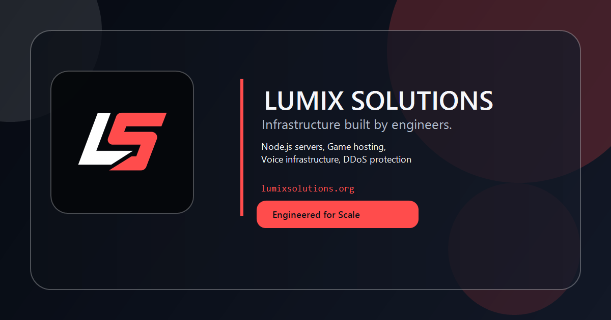

<p align="center"></p>

<h1 align="center">Lumix Website</h1>
<p align="center"><strong>Game servers, capped on purpose.</strong><br>The marketing site and storefront for Lumix Solutions — a finite number of servers, run properly.</p>

<p align="center">
  
  
  
  
</p>

<p align="center">
  <a href="#run-it-locally">Run it locally</a> ·
  <a href="#what-the-site-does">What it does</a> ·
  <a href="#project-structure">Structure</a> ·
  <a href="#deploy">Deploy</a> ·
  <a href="#documentation">Docs</a>
</p>



Lumix Solutions (lumixsolutions.org) sells game server hosting to the people who run game communities. The site presents the games, lists real plans at real prices, and hands the customer to WHMCS with the product preselected. It never takes payment itself, and it never claims a number it can't show.

> [!NOTE]
> **Two branches deploy.** Push to `main` and it goes live on lumixsolutions.org. Push to `dev` and it goes to dev.lumixsolutions.org (noindex). Both upload over FTPS to cPanel, see `.github/workflows/`. Work on `dev`, merge to `main` to ship.

## What the site does

|                                | On this site |
| ------------------------------ | ------------ |
| **Get someone into a cart**    | A one-job homepage, a per-game plan grid with real specs and prices, and a cart link that preselects the product and the region. |
| **Tell the truth about stock** | Capped inventory stated plainly, regions marked open or sold out, and a `/status` page that pings each node from the visitor's own browser — no invented uptime figure. |
| **Stay on brand**              | Near-black warm ground, a single Lumix red, Space Grotesk over Inter, hairlines instead of fills, and one structural diagonal. Colour comes from the games, not the palette. |
| **Earn trust without noise**   | A Trustpilot line only when there are real numbers, partners as a plain ledger, legal in Louisiana-governed Markdown, and consent-gated analytics that load zero bytes until accepted. |
| **Help after the click**       | A FiveM `server.cfg` generator, a migration walkthrough, a per-game "your first ten minutes," and a demo-panel button the moment a URL exists. |

New here? [**Read the onboarding guide →**](docs/ONBOARDING.md)

## Run it locally

Requirements: **Node.js 22.22+** (Astro 7), npm, and Git.

```sh
git clone https://github.com/LordOfTheCorgis/lumix-website.git
cd lumix-website
git checkout redesign
npm install
npm run dev
```

Open [http://localhost:4321](http://localhost:4321). Copy `.env.example` to `.env` for analytics — blank in dev is correct, so PostHog and the cookie banner render nothing. Production build and preview:

```sh
npm run build      # -> dist/
npm run preview
```

## Stack

- **Astro 7.4**, static output. **Node 22.22+.** No React, no framework runtime.
- **Tailwind 4.3** via `@tailwindcss/vite`; design tokens live in `src/styles/global.css` under `@theme` (no `tailwind.config.js`).
- **`cobe`** for the homepage/regions globe. The FAQ accordion is native `<details>` with a Web Animations height tween.
- **Astro content collections** — games and legal pages are schema-validated; a bad `pid` or a `live` game with no plans fails the build.
- **PostHog** analytics + cookie banner, consent-gated.

## Project structure

| Path | What |
| ---- | ---- |
| `src/content/games/*.yaml` | Game data: plans, WHMCS pids, prices, specs, art, logo. Validated by `src/content.config.ts`. |
| `src/content/legal/*.md` | Terms / privacy / ccpa, rendered via `src/pages/[slug].astro`. |
| `src/config.ts` | Everything non-game: site, promo, trust, bot hosting, demo panel, links, nav, social. |
| `src/lib/order.ts` | Builds the WHMCS cart link; the customer picks their region in WHMCS. |
| `src/lib/locations.ts` | Regions for the globe, `/regions`, and the ping test (`soldOut` per region). |
| `src/lib/ping.ts` | Browser-side latency probe shared by `PingTest` and `/status`. |
| `src/pages/` | File-based routes; `games/[slug].astro` and `[slug].astro` (legal) are the dynamic ones. |
| `src/assets/` | Images, imported through `astro:assets` (webp/srcset), not `public/`. |
| `src/styles/global.css` | Tailwind import + `@theme` design tokens. |

## Common tasks

| I want to… | Edit |
| ---------- | ---- |
| Add a game | A new `src/content/games/<slug>.yaml` + art in `src/assets/`. `status: planned` for a teaser, `live` needs plans. |
| Change a price | The plan's `pricing` block in its game YAML — and WHMCS, which is the real system of record. |
| Edit a legal page | `src/content/legal/{terms,privacy,ccpa}.md`; bump `lastUpdated`. |
| Change the promo, nav, or footer | `src/config.ts` (`promo`, `nav`/`moreNav`/`footerNav`, `links`). |
| Open or close a region | `soldOut` in `src/lib/locations.ts`. |

Each of these is walked through in [the onboarding guide](docs/ONBOARDING.md#common-tasks).

## Deploy

Push to `main` deploys to lumixsolutions.org (`deploy.yml`) and push to `dev` deploys to dev.lumixsolutions.org (`deploy-dev.yml`). Pull requests run `ci.yml`. How the FTP accounts, the guard step and the server-side `.htaccess` fit together is in [`docs/ONBOARDING.md`](docs/ONBOARDING.md#build--deploy).

<details>
<summary><strong>Environment variables</strong></summary>

Copy `.env.example` to `.env`. Names only, never commit values.

| Variable | Purpose |
| -------- | ------- |
| `PUBLIC_POSTHOG_KEY` | PostHog project API key. Blank in dev renders analytics and the cookie banner as nothing (intended). |
| `PUBLIC_POSTHOG_HOST` | `https://us.i.posthog.com` or the EU equivalent. |

`node scripts/make-icons.mjs` regenerates the favicon set from `src/assets/logo.png`.

</details>

## Documentation

| Start here | What you'll find |
| ---------- | ---------------- |
| [Onboarding](docs/ONBOARDING.md) | The full tour: stack, structure, common tasks, gotchas |
| [Handoff](HANDOFF.md) | Architecture, WHMCS contract, what exists, and the traps that cost time |
| [Design system](DESIGN.md) | The brand, the rules, and the signature element — read before touching anything visual |
| [Build plan](BUILD-PLAN.md) | The planned admin panel and the deploy decision |
| [TODO](TODO.md) | Evan's list — things only he can do |

## Troubleshooting

<details>
<summary><strong>Common dev-server gotchas</strong></summary>

- **The globe vanished** (`504 Outdated Optimize Dep` for cobe): hard reload; if it persists, `astro dev stop && npm run dev`, then delete `node_modules/.vite` as a last resort.
- **A new file's Tailwind classes are missing in dev only:** `astro dev stop && npm run dev`.
- **Content is stale after a schema change:** stop dev, delete `.astro/data-store.json`, restart. Never delete `.astro/` while the dev server runs.
- `astro dev` is a background daemon in Astro 7 — Ctrl+C doesn't stop it. Use `astro dev stop`.

The full catalogue is in [`HANDOFF.md`](HANDOFF.md#traps-that-already-cost-time).

</details>

<p align="center"><sub>© 2026 Lumix Solutions LLC · a finite number of servers, run properly</sub></p>
