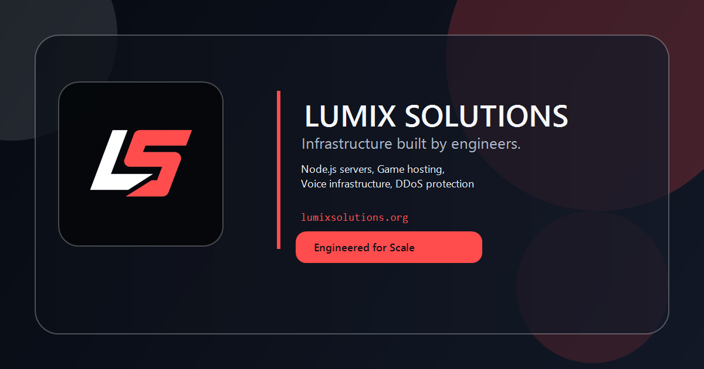

<p align="center"></p>

<h1 align="center">Lumix Website</h1>
<p align="center"><strong>Game server hosting, online in about a minute.</strong><br>The live marketing site and storefront for Lumix Solutions.</p>

<p align="center">
  
  
  
  
</p>

<p align="center">
  <a href="#run-it-locally">Run it locally</a> ·
  <a href="#what-the-site-does">What it does</a> ·
  <a href="#project-structure">Structure</a> ·
  <a href="#deploy">Deploy</a> ·
  <a href="#documentation">Docs</a>
</p>



Lumix Solutions (lumixsolutions.org) sells game server hosting to the people who run game communities — FiveM, Minecraft, Palworld, BeamMP, Terraria, with more on the way. This site owns product browsing and the "build your server" flow; it hands the finished configuration to WHMCS and never touches payment itself.

> [!NOTE]
> **This is the production branch, but deploy is now manual.** It no longer ships on push — run the workflow from the Actions tab. See [Deploy](#deploy).

## What the site does

|                               | On this site |
| ----------------------------- | ------------ |
| **Build a server, visually**  | A per-game builder island (`ServerBuilder.astro`) for plan, location, and billing cycle, with the price and cart URL updating as you click. It works with JavaScript off. |
| **Hand off a ready cart**     | The builder encodes everything into `cart.php?a=add&…&skipconfig=1&configoption[3]=…` and drops the customer into WHMCS with the config screen skipped. |
| **Show real status**          | `/status` pings the edge, billing, and panel, and reads a live incident list from GitHub — edit `status/incidents.json` on the web and it shows within ~5 minutes, no deploy. |
| **Stay one source of truth**  | Every pid, price, spec, and location lives in `src/data/catalog.ts`. Add a game or change a price in one file; the pages regenerate. |
| **Read as a real brand**      | Near-black ground, a single Lumix red, terminal accents, and generated key-art tiles where real cover art isn't set. |

New here? [**Read the onboarding guide →**](docs/ONBOARDING.md)

## Run it locally

Requirements: **Node.js 20 LTS+**, npm 10+, and Git. No `.env` needed — the site is fully static.

```sh
git clone https://github.com/LordOfTheCorgis/lumix-website.git
cd lumix-website
npm install
npm run dev
```

Open [http://localhost:4321](http://localhost:4321). Edits under `src/` hot-reload. Production build and preview:

```sh
npm run build      # -> dist/
npm run preview
```

## Stack

- **Astro 5**, fully static — no server runtime, no API routes, no database.
- **Tailwind 4** via `@tailwindcss/vite`; design tokens live in `src/styles/global.css` under `@theme` (no `tailwind.config.js`).
- **TypeScript**, strict. The one piece of client JS is the `ServerBuilder` island.
- **`@astrojs/sitemap`**, with a build hook that also writes a `sitemap.xml` alias.

## Project structure

| Path | What |
| ---- | ---- |
| `src/data/catalog.ts` | **Source of truth** for the builder: games, plans, WHMCS pids, prices, specs, locations. |
| `src/data/site.ts` | Banner, nav, links, stats, staff, services, status services, spotlight toggle. |
| `src/lib/orderUrl.ts` | Dependency-free cart-URL builder; ships to the browser, so it imports nothing. |
| `src/lib/whmcs.ts` | Server-side wrapper + price helpers. |
| `src/components/ServerBuilder.astro` | The builder island: plan/location/cycle pickers, live price, deploy link. |
| `src/pages/` | File-based routes; `games/[slug].astro` is the only dynamic one. Legal pages are hand-written `.astro`. |
| `src/styles/global.css` | Tailwind import + `@theme` design tokens. |
| `status/incidents.json` | The incident list on `/status`, read live from GitHub. |

## Common tasks

| I want to… | Edit |
| ---------- | ---- |
| Add a game | A `GameCategory` in `src/data/catalog.ts` + art at `public/images/games/<slug>.jpg`. |
| Change a price | The plan's `pricing` in `catalog.ts` — and WHMCS, which is the real system of record. |
| Sold-out a region | `soldOut: true` on its entry in `locationOptions` (`catalog.ts`). |
| Edit a legal page | `terms.astro` / `privacy.astro` / `ccpa.astro`; bump `lastUpdated`. |
| Change the promo or footer | `src/data/site.ts` (`announcementBanner`, `navigation`, `siteConfig.links`). |
| Post a status incident | `status/incidents.json` on github.com — see [`status/README.md`](status/README.md). |

Each of these is walked through in [the onboarding guide](docs/ONBOARDING.md#common-tasks).

## Deploy

**Deploy is manual.** `.github/workflows/deploy.yml` is `workflow_dispatch`-only — run it from the Actions tab once the deploy target is confirmed. It builds and `rsync --delete`s `dist/` to `/srv/www/lumixsolutions.org/`. Pushing to `main` does **not** ship the site.

`.github/workflows/status.yml` runs every ~5 minutes, probes the nodes and panel/billing via `scripts/status-check.mjs`, and writes results to an orphan `status-data` branch that `/status` reads live.

<details>
<summary><strong>Workflow secrets</strong></summary>

Set in GitHub, never committed.

| Secret | Purpose |
| ------ | ------- |
| `SSH_KEY` | Private key for the deploy user |
| `SERVER_IP` | Deploy target host |
| `SERVER_USER` | Deploy user |
| `STATUS_TARGETS` | What the status checker probes (format in `scripts/status-check.mjs`) |

</details>

## Documentation

| Start here | What you'll find |
| ---------- | ---------------- |
| [Onboarding](docs/ONBOARDING.md) | The full tour: stack, structure, common tasks, gotchas |
| [Handoff](HANDOFF.md) | The WHMCS integration contract: cart URLs, product IDs, the cart double-add issue |
| [Status incidents](status/README.md) | How to post and format an incident |

## Troubleshooting

- **Port 4321 in use:** `npm run dev -- --port 4322`.
- **Dependencies acting up:** `rm -rf node_modules package-lock.json && npm install`.
- **A color class doesn't exist:** add the token in `src/styles/global.css` under `@theme` — Tailwind 4 has no `tailwind.config.js` here.

<p align="center"><sub>© 2026 Lumix Solutions LLC · infrastructure built by engineers</sub></p>
